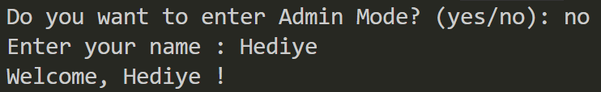
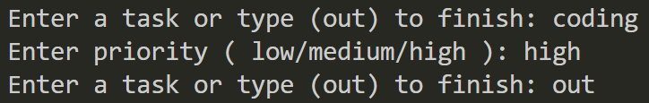
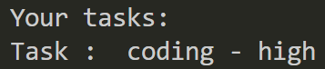
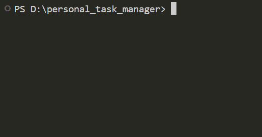

# Personal Task Manager


A Python-based personal task manager for creating, organizing and managing simple tasks

## Table of Contents

- [Features](#features)
- [Project Structure](#project-structure)
- [File Description](#file-description)
- [Requirements](#requirements)
- [Installation](#installation)
- [Environment Setup](#environment-setup)
- [Usage](#usage)
- [Example Output](#example-output)
- [Screenshots](#screenshots)
- [Demo](#demo)
- [Roadmap](#roadmap)
- [Contributing](#contributing)
- [License](#license)
- [Author](#author)

## Features

- Add new tasks
- View and manage personal tasks
- Track task completion status
- Save and load tasks in `tasks.txt`
- Assign priorities to tasks (Low, Medium, High)
- Access a simple Admin Mode protected by a password
- Loads the password from `.env`
- Organize code into separate Python modules

## Project Structure

```text
personal_task_manager/
├── pictures/
│   ├── screenshot1.png
│   ├── screenshot2.png
│   └── screenshot3.png
├── gifs/
│   └── demo.gif
├── main.py
├── tasks.py
├── .env.example
├── .gitignore
├── requirements.txt
└── README.md
```

## File Description

| File | Description |
| ------------------ | ------------------ |
| `main.py` | Runs the project and handles user interaction |
| `tasks.py` | Contains task-related functions and logic |
| `requirements.txt` | Lists the external Python packages required by the project |
| `.env.example` | Provides a template for required environment variables |
| `.gitignore` | Excludes private and generated files from Git tracking |
| `README.md` | Contains the project documentation |
| `pictures/` | Stores screenshots of the project |
| `gifs/` | Contains the project demo GIF |

## Requirements

Before running the project, make sure you have:
- `Python 3`
- `python-dotenv`

## Installation

1. Open a terminal in the project folder.

2. Check that python is installed:

```bash
python --version
```
3. Install the python packages:
```bash
pip install -r requirements.txt
```

## Environment Setup

1. Create a `.env` file from `.env.example` :
```bash
cp .env.example .env
```

2. Open new `.env` file

3. Replace `your_password_here` with your own password

```text
TASK_MANAGER_ADMIN_PASSWORD=your_password_here
```
4. Save the file

> Don't commit your `.env` file, because it may contains private information.

## Usage

1. Open a terminal in the project folder
2. Run the personal task manager

```bash
python main.py
```

3. Choose `yes` or `no` for admin mode
4. If you choose `yes`, enter the password from your `.env` file
5. Enter your name
6. Enter your tasks
7. Enter the priority
8. Your result is saved in `results.txt`

## Example Output
```text
Do you want to enter Admin Mode? (yes/no): no

Enter your name : Hediye

Welcome, Hediye !

Enter a task or type (out) to finish: coding
Enter priority ( low/medium/high ): high
Enter a task or type (out) to finish: out

Your tasks:
Task :  coding - high
```

## Screenshots

### Start page



### Task Management



### Task Status



## Demo



## Roadmap

- [x] Basic task management
- [x] Local file persistence
- [x] Admin Mode
- [x] Project documentation
- [x] Task priority management
- [ ] Improve input validation
- [ ] Add more task management features

## Contributing

--

## License

--

## Author

- Created by : [Hediye Ghahremani](https://github.com/hediye-ghahremani-me)
- Repository : [personal_task_manager](https://github.com/hediye-ghahremani-me/personal_task_manager)
